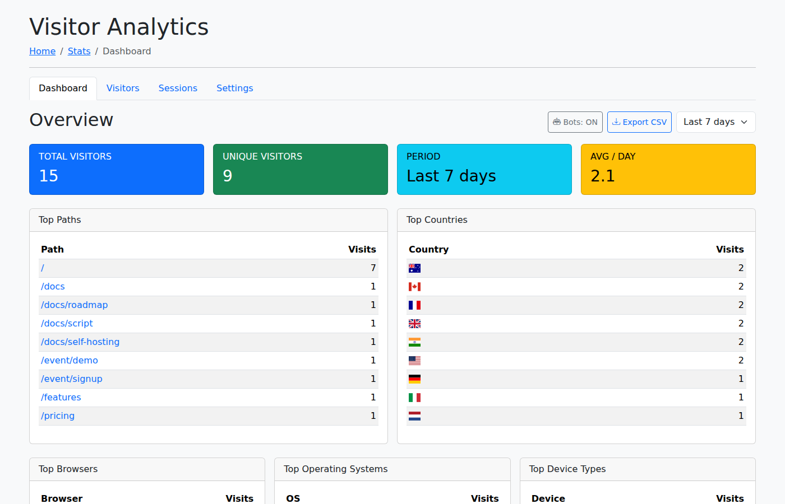
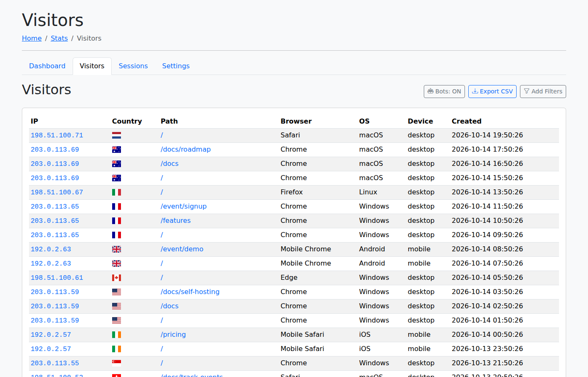
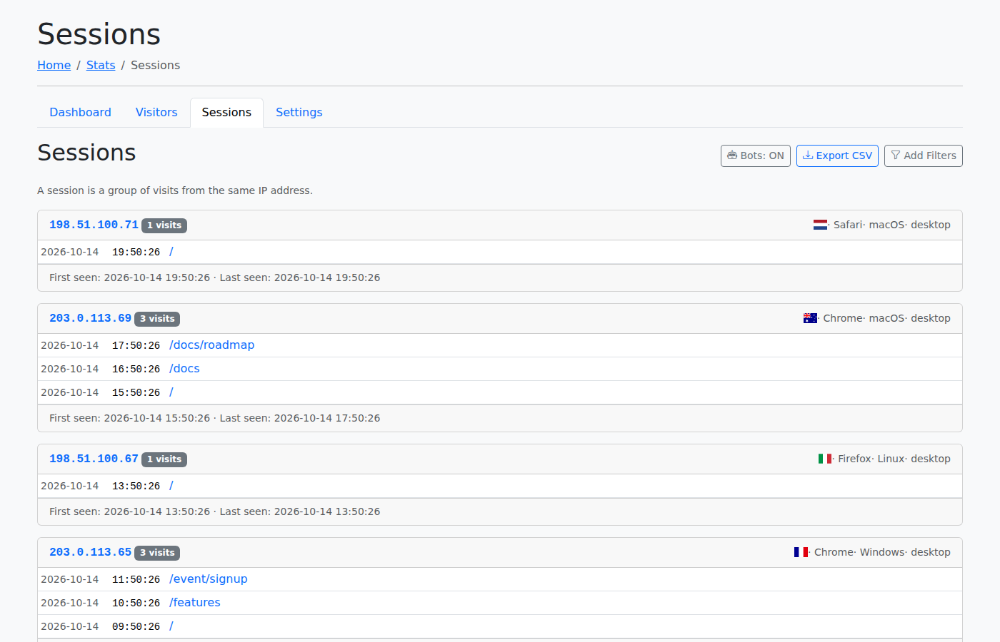
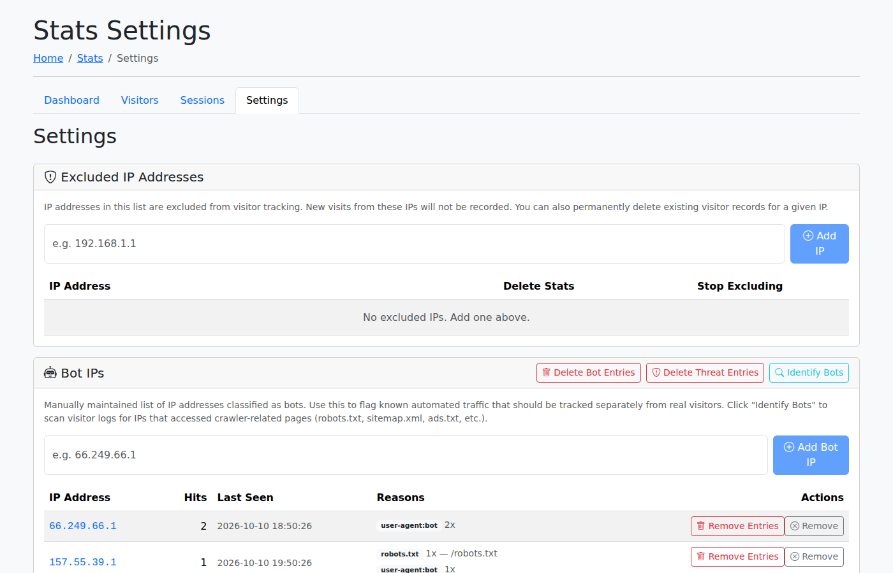
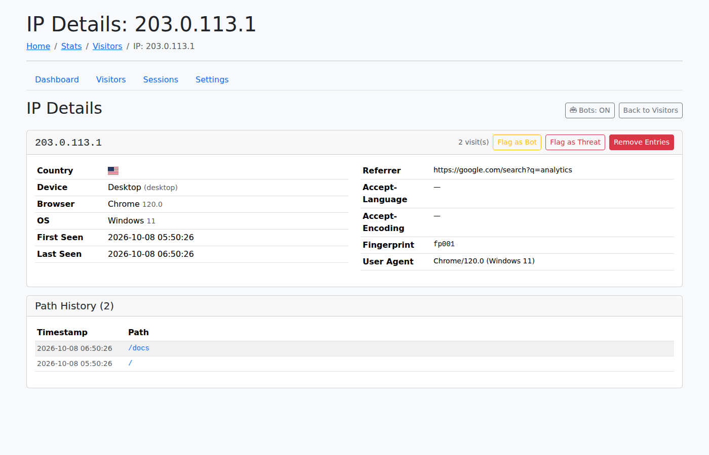

# statsadmin

[](https://github.com/dracory/statsadmin/actions/workflows/tests.yml)
[](https://goreportcard.com/report/github.com/dracory/statsadmin)
[](https://pkg.go.dev/github.com/dracory/statsadmin)

Embeddable admin dashboard for [`github.com/dracory/statsstore`](https://github.com/dracory/statsstore)
visitor analytics (extracted from the `statsstore` repository).

`statsadmin.New(...)` returns an `http.Handler` that serves a self-contained
Vue.js dashboard — no frontend build step. It depends only on
`github.com/dracory/statsstore` plus injected callbacks; it knows nothing
about the host application.

## Features

- **Dashboard** — total/unique visitors, sessions, bounce rate, avg session duration, pages per session, top paths/countries/browsers/OS/device types, recent visitors
- **Visitors** — paginated, filterable visitor list (IP, country, browser, OS, device type, path, date range, bot/threat flags), CSV export
- **Sessions** — visitor sessions grouped by IP with visit history, CSV export
- **IP Details** — per-IP deep dive with path history, bot-reason breakdown, flag as bot/threat, delete entries
- **Settings** — excluded IP management, bot IP management, included/excluded path patterns, automated bot identification, bulk delete bots/threats/visitors, CSV export
- **Security** — every action endpoint requires authentication (when `AuthUserID` is configured), `POST`, and an `X-Requested-With: XMLHttpRequest` header; `nosniff`/`no-store` are set centrally

## Usage

```go
import (
    "github.com/dracory/statsadmin"
    "github.com/dracory/statsstore"
)

handler, err := statsadmin.New(statsadmin.AdminOptions{
    Store:             store,            // required
    FuncLayout:        myFuncLayout,     // optional; built-in default when nil
    HomeURL:           "/admin",         // required
    BaseURL:           "/admin/stats",   // defaults to "/admin/stats"
    CountryNameByIso2: countryNameByIso2, // optional
    AuthUserID:        func(r *http.Request) string { /* ... */ }, // optional
    FlashError:        func(w, r, msg, url string, delay int) string { /* ... */ }, // optional
})

http.Handle("/admin/stats", handler)
```

`FuncLayout` wraps each dashboard page in your application's chrome:

```go
func myFuncLayout(w http.ResponseWriter, r *http.Request, title, body string, options statsadmin.LayoutOptions) string {
    // options.Styles / StyleURLs / Scripts / ScriptURLs carry per-page assets
    return "<html>..." + body + "...</html>"
}
```

### Controllers

| Controller | Query param | Description |
|---|---|---|
| Dashboard | `controller=dashboard` (default) | Overview stats and top-N breakdowns |
| Visitors | `controller=visitors` | Paginated, filterable visitor list |
| Sessions | `controller=sessions` | Sessions grouped by IP |
| Settings | `controller=settings` | Excluded/included paths, IPs, bots, stats |
| IP Details | `controller=ip-details&ip=X` | Per-IP details and actions |

## Example

A complete runnable demo with seeded data lives in `example/`:

```bash
go run ./example
# open http://localhost:8080
```

## Screenshots

### Dashboard



### Visitors



### Sessions



### Settings



### IP Details


